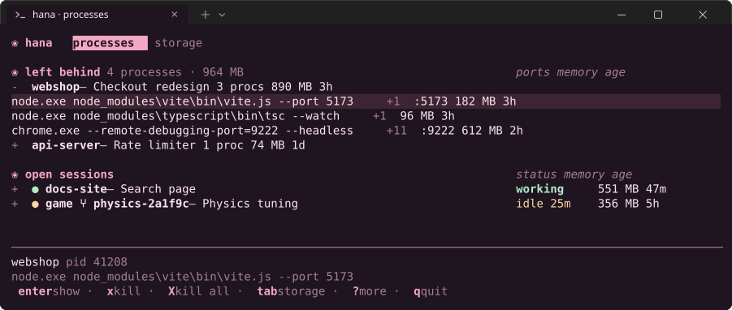
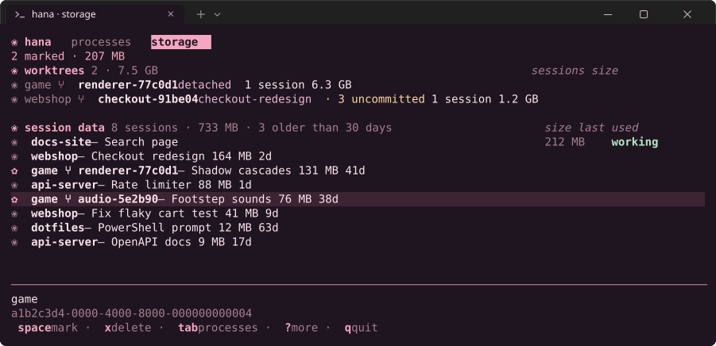
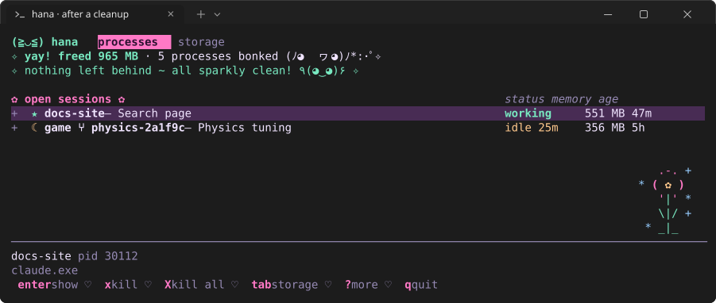

<p align="center">
  
</p>

<p align="center">
  
  
  
  <a href="https://github.com/cyber1998/hana/releases/latest"></a>
  <a href="https://github.com/cyber1998/hana/releases"></a>
  
  
</p>

<p align="center">
  <b>Claude Code sessions end. The dev servers, watchers, browsers and worktrees they started don't.</b><br>
  hana finds what they left behind, shows what it costs you, and cleans it up.
</p>

<p align="center"><sub><i>hana</i> (花) means <i>flower</i>.</sub></p>

<p align="center">
  
</p>

---

## ✿ Credits

hana is a Windows port of **[seshka](https://github.com/jigjoy-ai/seshka)** by the **[JigJoy](https://jigjoy.ai)** team, a macOS menu bar app that kills what Claude Code leaves behind.

seshka came up with the idea and the method this whole tool rests on: read the markers Claude Code leaves in every process's environment, and treat a process as left behind once its Claude Code is gone. Its session grouping, helper folding, protected programs and idle-session handling are all carried over here. hana rewrites it in Rust for Windows and adds a storage tab and themes.

seshka is MIT-licensed, Copyright (c) 2026 JigJoy, and that notice is kept in [LICENSE](LICENSE). If you're on a Mac, use the original: find it on **[GitHub](https://github.com/jigjoy-ai/seshka)** and **[Product Hunt](https://www.producthunt.com/products/seshka)**, and give it an upvote.

<p>
  <a href="https://www.producthunt.com/products/seshka"></a>
</p>

---

## ✿ Install

**1. Download it** (one line in PowerShell, nothing else to install)

```powershell
irm https://github.com/cyber1998/hana/releases/latest/download/hana.exe -OutFile "$env:LOCALAPPDATA\Microsoft\WindowsApps\hana.exe"
```

That folder is already on your `PATH`. Or grab `hana.exe` by hand from the **[latest release](https://github.com/cyber1998/hana/releases/latest)** and put it anywhere you like.

**2. Run it**

```powershell
hana
```

That's all. It's a single 1.3 MB file for 64-bit Windows 10 and 11, with no installer and no runtime. If Windows SmartScreen warns about a downloaded file, choose **More info → Run anyway**: the binary isn't code-signed.

<details>
<summary><b>On Linux</b> (x86-64, any distribution)</summary>

```sh
mkdir -p ~/.local/bin && curl -fsSL -o ~/.local/bin/hana https://github.com/cyber1998/hana/releases/latest/download/hana-linux-x86_64 && chmod +x ~/.local/bin/hana
```

Then run `hana`. It's a single static file with no dependencies. Session data goes to your desktop's trash (`~/.local/share/Trash`), and settings live in `~/.config/hana`. Copying needs `wl-copy` or `xclip`; under WSL, Windows' clipboard is used.

</details>

**Updating:** hana checks for a new release once a day and shows `v… available · U` in the corner. Press `U`, or run `hana update`. The download is checked against the release's SHA-256 checksums before it replaces anything.

<details>
<summary>Building from source instead</summary>

With [Rust](https://rustup.rs) installed (`winget install Rustlang.Rustup`):

```powershell
cargo install --git https://github.com/cyber1998/hana
```

Or from a clone:

```powershell
git clone https://github.com/cyber1998/hana
cd hana
cargo install --path .
```

</details>

---

## ✿ Sound familiar?

- *"Port 3000 is already in use"*, but nothing you started is running.
- Dozens of `node.exe`, `python.exe` or `chrome.exe` processes in Task Manager, eating memory after Claude Code closed.
- Playwright or Puppeteer browsers that never went away.
- `~/.claude` growing by gigabytes, and old git worktrees under `.claude\worktrees` that you forgot about.

Claude Code starts dev servers, watchers, MCP servers and test browsers for you. On Windows, when a session ends, those child processes are often orphaned and keep running. hana is a small terminal app that finds exactly those processes, tells you which session started them, and ends them, along with stale session data and worktrees.

---

## ✿ What it does

|  | Processes tab | Storage tab |
| --- | --- | --- |
| **Finds** | Every process started by a Claude Code session that has since closed, grouped by session, with ports, memory and age | Every session's data on disk, and every git worktree in the repositories your sessions worked in |
| **Shows** | Open sessions too: working or idle, for how long, and what they hold | How much each one weighs, and for worktrees whether they hold uncommitted work |
| **Cleans** | One process, one session's worth, or all of them, along with whatever they started | Session data goes to the Recycle Bin; worktrees are removed through git |

On top of that:

- **Browsers count as one row.** A browser opened by Playwright appears once, with its helper processes and console host folded in.
- **Idle sessions can be ended**, either when you ask or automatically after a limit you set. Auto-ending is off by default.
- **Protected programs** are never touched by bulk kills.
- **Eleven themes**, shown below.

<p align="center">
  
</p>

<p align="center">
  
</p>

<p align="center"><sub>Screens are drawn by hana itself from made-up sessions: <code>cargo test --release readme_screens -- --ignored</code> redraws them.</sub></p>

---

## ✿ Themes

<p align="center">
  
</p>

hana starts in **cherry-blossom**, after its name. **rust** is Rust's own orange on your terminal's background (it used to be called *original*, and that name still works). Press `t` / `T` in the app to cycle through them, or pick one directly:

```powershell
hana --theme cherry-blossom
```

`hana themes` prints all of them with their colors. Your choice is remembered.

When a cleanup or delete succeeds, a small flower grows in the corner. ✿

---

## ✿ Use

```text
hana [--storage]                       open the interactive view (on the storage tab)
hana list [--json]                     print leftovers and open sessions
hana kill-all [-y]                     kill every leftover process (except protected ones)
hana kill-idle [-y]                    end sessions idle longer than the limit

hana disk [--json]                     how much each worktree and session's data weighs
hana delete-session <id>... [-y]       move sessions' data to the Recycle Bin (ID or prefix)
hana remove-worktree <name> [--force]  git worktree remove; --force also drops uncommitted work

hana update [--check]                  update to the latest release
hana themes · hana --theme <name> · hana config · hana --help
```

<details>
<summary><b>Keys</b></summary>

| Everywhere | |
| --- | --- |
| `↑ ↓` `j k` | move |
| `Tab` `1` `2` | switch between processes and storage |
| `t` / `T` | next / previous theme |
| `c` / `o` | copy the command, ID or path / open the folder in Explorer |
| `s` / `?` / `q` | settings / all keys / quit |
| `U` | update hana, when a new version is out |

| Processes tab | |
| --- | --- |
| `enter` `→` `←` | show or hide a session's processes |
| `x` `Del` | kill the selected process, or the whole session. On an open session, end it (asks first) |
| `X` | kill everything left behind (asks first) |
| `i` | end sessions idle past the limit (asks first) |
| `p` | protect / unprotect the selected program |
| `r` `F5` | scan now |

| Storage tab | |
| --- | --- |
| `space` | mark a worktree or session |
| `M` / `u` | mark sessions untouched for 30+ days / unmark all |
| `x` `Del` | delete what's marked, or the selected row (asks first) |
| `r` | scan and measure again |

</details>

Settings (scan interval, idle limit, auto-end, protected programs, theme, update checks) are in `%APPDATA%\hana\config.json`, and you can change them in the app with `s`.

---

## ✿ Safe by design

- **Ending a live session, bulk kills, and every delete ask first.** Killing a leftover process, or one closed session's leftovers, takes one keypress, as in seshka. Auto-ending idle sessions only happens if you turn it on.
- **A PID is never trusted on its own.** Windows reuses process IDs quickly, so every kill first checks the process's creation time.
- **Session data goes to the Recycle Bin**, never deleted for good. Open sessions are skipped, and so is each project's `memory/` folder.
- **Worktrees are removed through `git worktree remove`**, so their branches stay. A worktree with uncommitted changes or commits that no branch points to is only removed if you press `F`. One that a running process is working in is never removed.
- **Nothing about you leaves your machine.** The only network request is the daily check for a new release on GitHub, which you can turn off in settings.

<details>
<summary><b>How it works</b></summary>

Claude Code sets `CLAUDECODE=1`, the session's ID and its own PID in the environment of everything it starts. seshka reads those with `ps` on macOS. Windows has no tool for that, so hana reads each process's environment, command line and working directory directly from its PEB, for processes under your own account. A process counts as left behind once the Claude Code that started it is gone.

On Windows a few things need extra care:

- **Parent IDs go stale.** Orphaned processes aren't re-parented, so a "parent" only counts if it was created before its child.
- **Claude Desktop is also `claude.exe`.** The Claude Code CLI is told apart by its session record (`~/.claude/sessions/<pid>.json`, matched by creation time) and its install path.
- **There's no SIGTERM.** Apps with a window are sent `WM_CLOSE` and given two seconds to close. Anything still running is ended.
- **Children outlive their parents.** Killing a row also ends what it started, except protected programs.

Each session's data lives in `~/.claude`:

- the transcript: `projects/<project>/<id>.jsonl`
- subagent and tool output: `projects/<project>/<id>/`
- `file-history/<id>/` and `session-env/<id>/`
- older `todos/` and `debug/` files

Worktrees are found with `git worktree list` in every repository a session worked in, plus any stray folders under `.claude\worktrees`.

Processes running elevated or as another user can't be inspected from a normal terminal. Run hana as administrator to see those too.

</details>

---

<p align="center">
  <sub>MIT · built on <a href="https://github.com/jigjoy-ai/seshka">seshka</a> by <a href="https://jigjoy.ai">JigJoy</a> (<a href="https://www.producthunt.com/products/seshka">Product Hunt</a>) · ❀</sub>
</p>
